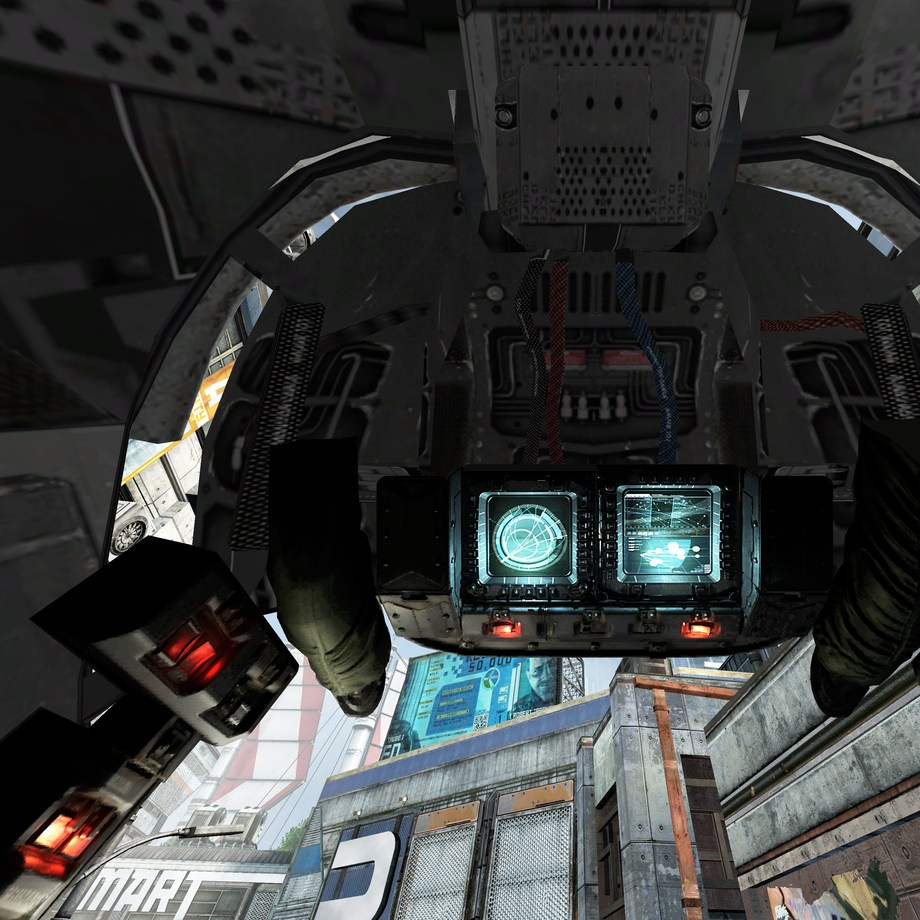

> [!IMPORTANT]
> **💬 DOWNLOAD & DISCUSSION**
>
> **[Join the Flat2VR Discord](https://discord.gg/P4q9zt7ek)** · **[Open the Titanfall 1 thread](https://discord.com/channels/747967102895390741/1563500399753822339)**
>
> Get the mod and share feedback in the game’s Flat2VR thread.

  

## 📦 INSTALLATION

1. Install **Titanfall 1** and the [**R1Delta launcher**](https://r1delta.net/). Run the game once. The [R1Delta Discord](https://discord.r1delta.net/) has launcher setup help.
2. **Put the mod archive in Titanfall’s `t1` folder**, which contains `bin`, `r1`, and `vpk`. Extract it there and keep the entire `PUT_ME_IN_GAME_FOLDER` folder.
3. Connect your PC VR headset, open the extracted `PUT_ME_IN_GAME_FOLDER` folder, and run **`RUN_TITANFALL_VR.bat`**.

## ⚡ FEATURES

### FIGHT AS A PILOT AND FROM INSIDE A TITAN

Play as a Pilot in VR, then embark and look around your Titan’s cockpit in stereo.

### KEEP YOUR GUN ON TARGET AS YOU LOOK AWAY

Aim with your weapon hand. Look to the side without taking your gun off its target.

Online PvP is experimental.

## 📸 In-game screenshots

  
  

[Tester credits](TESTERS.md)

## 🎮 Other VR mods

| VR mod | Highlights |
| --- | --- |
| [Alone in the Dark (2008) VR](https://github.com/Monsterdeadwood/AloneInTheDark2008VR) | Tracked item handling and hand contact with walls |
| [Battlefield 3: VRevamp](https://github.com/Monsterdeadwood/Battlefield-3-VRevamp) | Body holsters, two-handed aiming, and changing campaign skies |
| [Burnout Paradise Remastered VR](https://github.com/Monsterdeadwood/BUrnOutPvr) | Head-tracked driving with stereo boost and exhaust effects |
| [Crysis 2: VRevamp](https://github.com/Monsterdeadwood/C2VR) | Telekinesis, switchable weapon hands, and randomized weather and time of day |
| [NOVA · CS:GO Legacy VR](https://github.com/Monsterdeadwood/CSGOVR) | Controller aiming and working optics in local bot matches |
| [Metro 2033 VR](https://github.com/Monsterdeadwood/Metro2033VR) | Telekinesis, hand lightning, and object physics |
| [Rainbow Six Siege VR](https://github.com/Monsterdeadwood/SiegeVR) | Tracked weapons and two-handed foregrip handling |
| [Star Wars: The Force Unleashed II VR](https://github.com/Monsterdeadwood/TFU2VR) | Independent sabers, limb cuts, Force powers, and crate flight |
| [TimeShift VR](https://github.com/Monsterdeadwood/TimeShiftVR) | Randomized weather, day and night, and roomscale crouching |
| [You Are Empty: Absolute Edition VR](https://github.com/Monsterdeadwood/YouAreEmptyAEVR) | Tracked weapons and melee with either hand |
