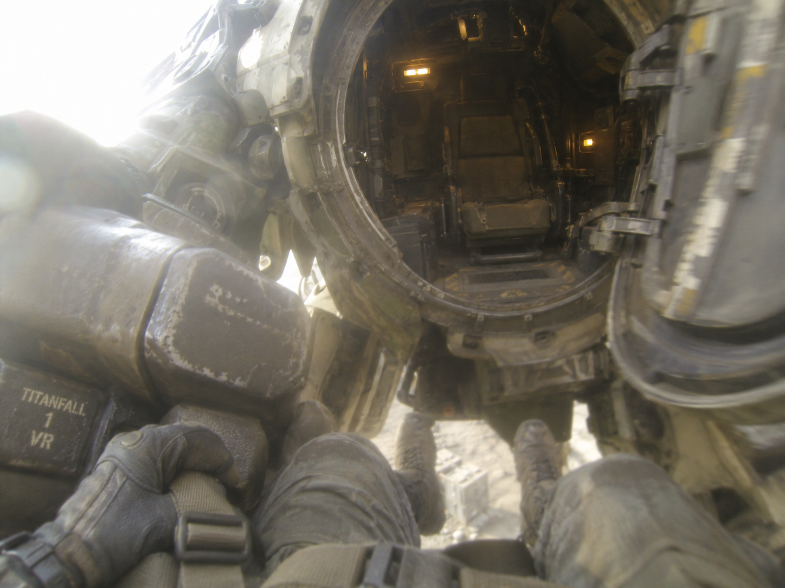

> [!IMPORTANT]
> **DOWNLOAD & DISCUSSION**
>
> **[Join the Flat2VR Discord](https://discord.gg/P4q9zt7ek)** · **[Open the Titanfall 1 thread](https://discord.com/channels/747967102895390741/1563500399753822339)**
>
> Get the mod and share feedback in the game’s Flat2VR thread.

  

## Features

**Stereo head tracking · Motion-controlled aiming · Pilot and Titan controls · Vortex Shield and ejection**

###  Call down your Titan and climb into the cockpit

Tap the right stick down to call your Titan and hold the use button to embark. Once inside, look around the cockpit in stereo and aim the Titan’s weapon with your controller.

###  Catch incoming rounds and send them back

With Vortex Shield equipped, hold the left trigger to catch incoming fire. Release the trigger to send the rounds back.

###  Dash, activate your core and eject

Dash across open ground and trigger your Titan’s core when it charges. On Touch controllers, hold the right stick down to arm ejection, then press X three times to bail out.

###  Double-jump into a fight as a Pilot

Sprint for cover, double-jump for a new angle and fire your weapon with the right trigger. Switch to your anti-Titan weapon with the left trigger when a Titan shows up.

Online PvP is experimental.

## Installation

1. Install **Titanfall 1** and the [**R1Delta launcher**](https://r1delta.net/). Run the game once. The [R1Delta Discord](https://discord.r1delta.net/) has launcher setup help.
2. **Put the mod archive in Titanfall’s `t1` folder**, which contains `bin`, `r1`, and `vpk`. Extract it there and keep the entire `PUT_ME_IN_GAME_FOLDER` folder.
3. Connect your PC VR headset, open the extracted `PUT_ME_IN_GAME_FOLDER` folder, and run **`RUN_TITANFALL_VR.bat`**.

## In-game screenshots

  
  

[Tester credits](TESTERS.md)

## Other VR mods

| VR mod | Highlights |
| --- | --- |
| [Alone in the Dark (2008) VR](https://github.com/Monsterdeadwood/AloneInTheDark2008VR) | Sweep a flashlight across the room, then grab a chair and carry it by hand. |
| [Battlefield 3: VRevamp](https://github.com/Monsterdeadwood/Battlefield-3-VRevamp) | Pull a dropped enemy rifle toward you, take it with your other hand and fire. |
| [Burnout Paradise Remastered VR](https://github.com/Monsterdeadwood/BUrnOutPvr) | Look into a corner, drift through it and hit boost as you straighten out. |
| [Crysis 2: VRevamp](https://github.com/Monsterdeadwood/C2VR) | Lift an enemy with your free hand and fling them across the room with a swing. |
| [NOVA · CS:GO Legacy VR](https://github.com/Monsterdeadwood/CSGOVR) | Bring the AWP’s scope up to your eye and feel the kick when you shoot. |
| [Metro 2033 VR](https://github.com/Monsterdeadwood/Metro2033VR) | Ricochet a glowing power core down a tunnel and watch it light the walls as it travels. |
| [Rainbow Six Siege VR](https://github.com/Monsterdeadwood/SiegeVR) | Reach for the rifle’s foregrip and steer the muzzle with both hands. |
| [Star Wars: The Force Unleashed II VR](https://github.com/Monsterdeadwood/TFU2VR) | Hold a Stormtrooper in the air with the Force and swing a lightsaber with your other hand. |
| [TimeShift VR](https://github.com/Monsterdeadwood/TimeShiftVR) | Let go of the foregrip for a quick punch, or strike with the rifle itself. |
| [You Are Empty: Absolute Edition VR](https://github.com/Monsterdeadwood/YouAreEmptyAEVR) | Keep your gun trained ahead with your right hand and strike with your free left. |
