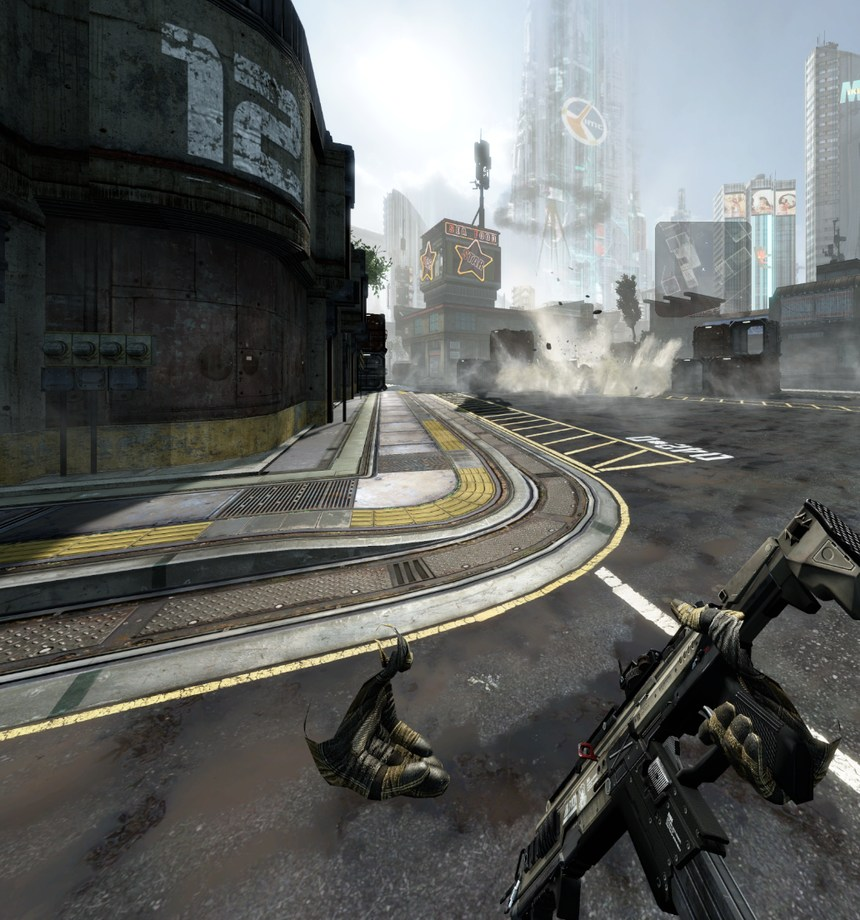

> [!IMPORTANT]
> **💬 TEST BUILDS & DISCUSSION**
>
> **[Join the Flat2VR Discord](https://discord.gg/P4q9zt7ek)** · **[Open the Titanfall 1 thread](https://discord.com/channels/747967102895390741/1563500399753822339)**
>
> Download the latest test build from the thread and share your results there.

  

## 📦 INSTALLATION

1. Install **Titanfall 1** and [**R1Delta 3.0.5**](https://github.com/r1delta/r1delta/releases/download/v3.0.5/R1DeltaSetup.exe). Join the [R1Delta Discord](https://discord.r1delta.net/) for launcher setup and run the game once.
2. Copy the full **`PUT_ME_IN_GAME_FOLDER`** folder into the game’s `t1` folder, beside `bin`, `r1` and `vpk`.
3. Connect your PC VR headset and run **`RUN_TITANFALL_VR.bat`** beside the `TF1VR` folder inside the package.

## ⚡ FEATURES

### AIM WITH YOUR HAND. LOOK WHERE YOU WANT.

The gun follows your controller independently of the headset. Keep it on target while you turn your head.

### FIGHT FROM INSIDE THE TITAN

Play as the Pilot and look around the Titan cockpit in head-tracked stereo.

### SHOTS FOLLOW THE CONTROLLER ON A LOCAL SERVER

A separate aim test matched the direction of 240 shots on the client and a local server with the R101, P2011 and Titan XO16.

The stereo cockpit and shot-direction checks used separate XR Sim builds. The PvP build is experimental; public-server hit registration still needs testing.

## 📸 In-game screenshots

  
  

[Tester credits](TESTERS.md) · [Build details](docs/PROJECT_STATUS.md)

## 🎮 Other VR mods

- [Alone in the Dark (2008) VR](https://github.com/Monsterdeadwood/AloneInTheDark2008VR)
- [Battlefield 3: VRevamp](https://github.com/Monsterdeadwood/Battlefield-3-VRevamp)
- [Burnout Paradise Remastered VR](https://github.com/Monsterdeadwood/BUrnOutPvr)
- [Crysis 2: VRevamp](https://github.com/Monsterdeadwood/C2VR)
- [NOVA · CS:GO Legacy VR](https://github.com/Monsterdeadwood/CSGOVR)
- [Metro 2033 VR](https://github.com/Monsterdeadwood/Metro2033VR)
- [Rainbow Six Siege VR](https://github.com/Monsterdeadwood/SiegeVR)
- [Star Wars: The Force Unleashed II VR](https://github.com/Monsterdeadwood/TFU2VR)
- [TimeShift VR](https://github.com/Monsterdeadwood/TimeShiftVR)
- [You Are Empty: Absolute Edition VR](https://github.com/Monsterdeadwood/YouAreEmptyAEVR)
