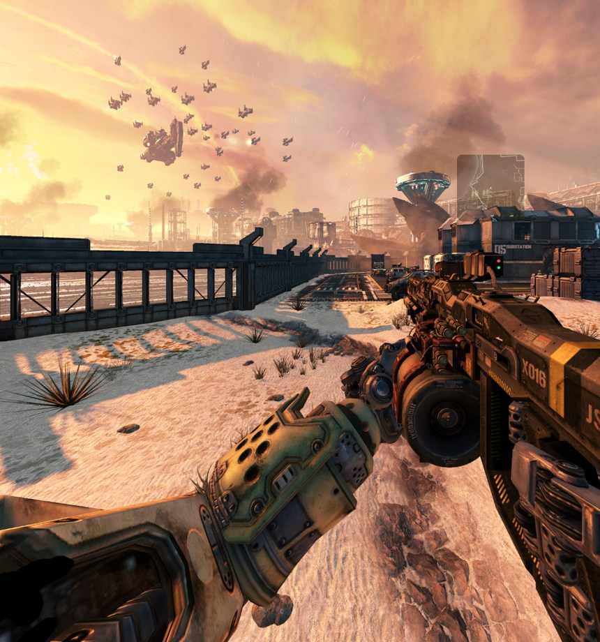

> [!IMPORTANT]
> **💬 DOWNLOAD & DISCUSSION**
>
> **[Join the Flat2VR Discord](https://discord.gg/P4q9zt7ek)** · **[Open the Titanfall 1 thread](https://discord.com/channels/747967102895390741/1563500399753822339)**
>
> Get the mod and share feedback in the game’s Flat2VR thread.

  

## 📦 INSTALLATION

1. Install **Titanfall 1** and the [**R1Delta launcher**](https://r1delta.net/). Run the game once. The [R1Delta Discord](https://discord.r1delta.net/) has launcher setup help.
2. **Put the mod archive in Titanfall’s `t1` folder**, which contains `bin`, `r1`, and `vpk`. Extract it there and keep the entire `PUT_ME_IN_GAME_FOLDER` folder.
3. Connect your PC VR headset, open the extracted `PUT_ME_IN_GAME_FOLDER` folder, and run **`RUN_TITANFALL_VR.bat`**.

## ⚡ FEATURES

### 🦾 Call down your Titan and climb into the cockpit

Tap the right stick down to call your Titan and hold the use button to embark. Once inside, look around the cockpit in stereo and aim the Titan’s weapon with your controller.

### 🛡️ Catch incoming rounds and send them back

With Vortex Shield equipped, hold the left trigger to catch incoming fire. Release the trigger to send the rounds back.

### 🚀 Dash, activate your core and eject

Dash across open ground and trigger your Titan’s core when it charges. On Touch controllers, hold the right stick down to arm ejection, then press X three times to bail out.

### 🪂 Double-jump into a fight as a Pilot

Sprint for cover, double-jump for a new angle and fire your weapon with the right trigger. Switch to your anti-Titan weapon with the left trigger when a Titan shows up.

Online PvP is experimental.

## 📸 In-game screenshots

  
  

[Tester credits](TESTERS.md)

## 🎮 Other VR mods

| VR mod | Highlights |
| --- | --- |
| [Alone in the Dark (2008) VR](https://github.com/Monsterdeadwood/AloneInTheDark2008VR) | Aim a light by hand, carry a chair, and throw bottles |
| [Battlefield 3: VRevamp](https://github.com/Monsterdeadwood/Battlefield-3-VRevamp) | Pull dropped guns toward you, draw from body slots, and fight through changing weather |
| [Burnout Paradise Remastered VR](https://github.com/Monsterdeadwood/BUrnOutPvr) | Pull the handbrake, hit boost, and look around while racing |
| [Crysis 2: VRevamp](https://github.com/Monsterdeadwood/C2VR) | Hit enemies with your fists or weapon, throw them with telekinesis, and swap weapon hands |
| [NOVA · CS:GO Legacy VR](https://github.com/Monsterdeadwood/CSGOVR) | Aim and feel recoil, take scoped shots, and buy gear from the controllers |
| [Metro 2033 VR](https://github.com/Monsterdeadwood/Metro2033VR) | Lift an enemy, shock them with your hand, or bounce a glowing core down a tunnel |
| [Rainbow Six Siege VR](https://github.com/Monsterdeadwood/SiegeVR) | Brace a rifle by its foregrip, drop prone and use gadgets |
| [Star Wars: The Force Unleashed II VR](https://github.com/Monsterdeadwood/TFU2VR) | Ignite two sabers independently, cut limbs, and ride a crate with the Force |
| [TimeShift VR](https://github.com/Monsterdeadwood/TimeShiftVR) | Punch or hit with your weapon, control time, and fight through changing weather |
| [You Are Empty: Absolute Edition VR](https://github.com/Monsterdeadwood/YouAreEmptyAEVR) | Shoot with one hand, hit with either, and reach out against walls |
