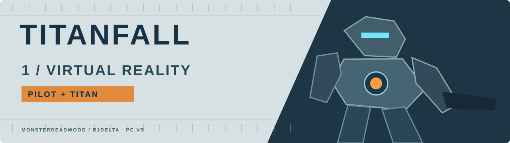

> [!IMPORTANT]
> **[ТЕСТИРОВАНИЕ И ОБСУЖДЕНИЕ · FLAT2VR DISCORD](https://discord.gg/P4q9zt7ek)**
> Тестирование, запрос сборок, отзывы и обсуждение проходят в **Flat2VR Modding Discord**. Перейди на сервер и найди тему **Titanfall 1 VR**.

# Titanfall 1 VR

[English](README.md) · [Русский](README_RU.md) · [Flat2VR Discord](https://discord.gg/P4q9zt7ek) · [All projects](PORTFOLIO.md)

VR-ветка Titanfall 1 для поддерживаемых сборок R1Delta: стереообзор, прицеливание пилота и работа с кабинами титанов. Спасибо команде [R1Delta](https://r1delta.net/) за общественную платформу.

**Текущая описанная ветка: R1Delta 3.0.5 stereo-camera/loadout test; separate weapon-direction candidate.**

## Установка

**Зайди в [Discord R1Delta](https://discord.r1delta.net/)** — там установка R1Delta, обновления лаунчера и поддержка сообщества.

| Компонент | Скачать / источник | Версия / выбор |
| --- | --- | --- |
| **R1Delta launcher** | [R1DeltaSetup.exe — скачать](https://github.com/r1delta/r1delta/releases/download/v3.0.5/R1DeltaSetup.exe) · [страница версии](https://github.com/r1delta/r1delta/releases/tag/v3.0.5) | R1Delta 3.0.5 — версия текущего описанного VR-кандидата. |
| **VR test package** | [Запросить подходящую VR-сборку на Flat2VR](https://discord.gg/P4q9zt7ek) | Тест Titanfall 1 VR стереокамеры/снаряжения. Установщик лаунчера выше не содержит этот VR-пакет. |

1. Скачай **R1DeltaSetup.exe 3.0.5** по ссылке выше и установи общественный лаунчер. Исходный проект — [r1delta/r1delta](https://github.com/r1delta/r1delta); [r1delta.net](https://r1delta.net/) ведёт к этому же семейству лаунчера.
2. Подготовь свою поддерживаемую установку Titanfall 1 в R1Delta. Один раз запусти обычную игру и закрой её. Найди игровую папку **t1**, в которой находятся **bin**, **r1** и **vpk**.
3. Запроси совместимый пакет **Titanfall 1 VR / R1Delta 3.0.5** в теме игры на Flat2VR. Описанный кандидат камеры/снаряжения — локальная экспериментальная сборка, а не общедоступный релиз.
4. Скопируй полную папку **PUT_ME_IN_GAME_FOLDER** в **t1**, рядом с bin, r1 и vpk. **RUN_TITANFALL_VR.bat** должен оставаться рядом с папкой **TF1VR** пакета. Нужен каталог игровых данных, а не папка приложения R1Delta.
5. Подключи PC VR, выбери свой OpenXR runtime и запусти **RUN_TITANFALL_VR.bat**. Оставь консоль открытой. Первый запуск может один раз скачать фиксированную зависимость.
6. Откроется обычное меню игры. Следуй согласованному локальному сценарию: текущий кандидат не подтверждает совместимость публичных матчей с людьми. Управление — в **TF1VR/assets/controls/TOUCH_LAYOUT.json**.
7. После теста пришли свежий ZIP сеанса из **SEND_ME_TO_DISCORD** в тему Flat2VR. После прерывания **RUN_TITANFALL_VR.bat --restore** восстанавливает известные исходные файлы.

Доступность актуальных тестовых пакетов уточняется в Discord. Нужен полный пакет для поддерживаемой версии игры; страница проекта сама по себе не является скачиваемым релизом.

## Что есть в проекте

- Стерео и трекинг камеры пилота/титана в экспериментальной ветке.
- Прицеливание от контроллера с сохранением родного поведения оружия.
- Отдельная работа над согласованием родного направления выстрела клиента и сервера.
- Последняя контролируемая проверка охватила 16 классов оружия, включая оружие титанов.

<b>Краткое управление</b>

| Действие / кнопка | Назначение |
| --- | --- |
| Right trigger | Огонь |
| A | Пилот: прыжок / двойной прыжок; титан: рывок |
| B | Переключить приседание |
| X tap / hold | Перезарядка / взаимодействие, взлом или посадка; в титане удерживать — выйти |
| Y tap / hold | Сменить оружие / подобрать оружие |
| Left trigger | Пилот: противотитанное оружие; титан: защита / Vortex Shield |
| Left grip / right grip | Боеприпас-граната / тактическая способность |
| Left stick click / right stick click | Ближний бой / бег |
| Right stick down tap | Пилот: вызвать титана / следовать-охранять; титан: способность ядра |
| Right stick down hold 0.4 s, in Titan | Подготовить катапультирование, затем три раза нажать X |
| Right stick up | Счёт |
| Left Menu tap / hold 0.4 s | Сброс камеры / игровое меню |

Полная инструкция управления в конкретной сборке учитывает её версию и профиль контроллеров.

## Текущий статус

**Локальный тестовый кандидат.** Кандидат стереокамеры/снаряжения R1Delta 3.0.5 прошёл локальные проверки пилота и титана в настоящей игре/XR Sim. Он отделён от исследования нативного направления для 16 видов оружия.

- Последние проверки прицеливания не подтверждают принятие в физическом шлеме и совместимость публичного PvP с людьми.
- В последнем кандидате серверная точка выстрела остаётся штатной, от игрока. Совпадение конечных попаданий, всё оружие и способности ещё требуют проверки.
- Сообщение о перевороте SteamVR ещё требует подтверждения в физическом шлеме. Vortex использует штатную серверную точку; полная позиционная физика левого щита не завершена.

Родное предсказание выстрела, кабины и расширение арсенала развиваются в отдельных контролируемых кандидатах.

[Подробный статус и область проверки](docs/PROJECT_STATUS.md)

## Тестирование и отзывы

Напиши в [тему игры на Flat2VR](https://discord.gg/P4q9zt7ek): укажи **версию мода, игру/магазин, шлем, OpenXR runtime, GPU, шаги воспроизведения и диагностический ZIP сборки**. Для проблем изображения или управления полезно короткое видео.

## Другие мои VR-моды

| Игра / проект | Направление | Доступ |
| --- | --- | --- |
| [Assassin’s Creed VR](https://github.com/Monsterdeadwood/AC1VR) | Обзор от первого лица, лазание и меч | Закрытый |
| [Crysis 2: VRevamp](https://github.com/Monsterdeadwood/C2VR) | Нанокостюм, физическое взаимодействие и интерфейс | Открытый |
| [NOVA · CS:GO Legacy VR](https://github.com/Monsterdeadwood/CSGOVR) | Локальные матчи CS:GO Legacy с VR-управлением | Открытый |
| [TimeShift VR](https://github.com/Monsterdeadwood/TimeShiftVR) | Управление временем, девять видов оружия и позы | Открытый |
| [You Are Empty: Absolute Edition VR](https://github.com/Monsterdeadwood/YouAreEmptyAEVR) | Absolute Edition в VR, оружие и взаимодействие | Открытый |
| [Alone in the Dark 2008 VR](https://github.com/Monsterdeadwood/AloneInTheDark2008VR) | VR-хоррор и взаимодействие с предметами | Открытый |
| [Rainbow Six Siege VR](https://github.com/Monsterdeadwood/SiegeVR) | Стерео и оружие от контроллеров в старой Siege | Открытый |
| [Burnout Paradise Remastered VR](https://github.com/Monsterdeadwood/BUrnOutPvr) | Стереовождение, меню автомобилей и эффекты | Открытый |
| [Metro 2033 VR](https://github.com/Monsterdeadwood/Metro2033VR) | Оригинальная Metro в VR и нативная физика | Открытый |
| [Insurgency VR](https://github.com/Monsterdeadwood/InsurgencyVR) | Начальная подготовка VR-интеграции | Закрытый |
| [Counter-Strike: Source VR](https://github.com/Monsterdeadwood/CSSVR) | Разработка VR для Counter-Strike: Source | Закрытый |

Ссылки на закрытые репозитории доступны приглашённым участникам. Открытые страницы отмечены в таблице.

## Авторство и заметки разработки

Проект ведёт [Monsterdeadwood](https://github.com/Monsterdeadwood). Это независимый фанатский VR-проект; нужна собственная поддерживаемая копия оригинальной игры.

Общественная платформа: команда [R1Delta](https://r1delta.net/).

[Прежний обзор репозитория, сохранённый как история](README_RESEARCH_ARCHIVE.md).

Описание сверено: **14 ноября 2026 года**.
